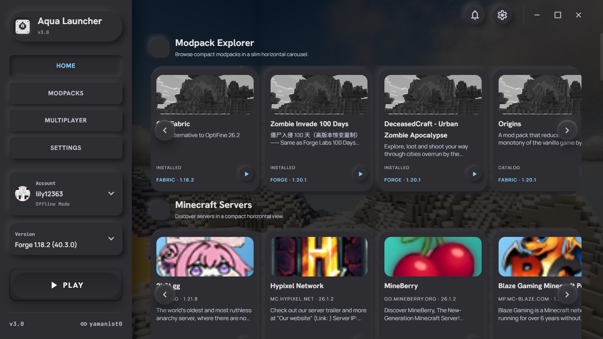
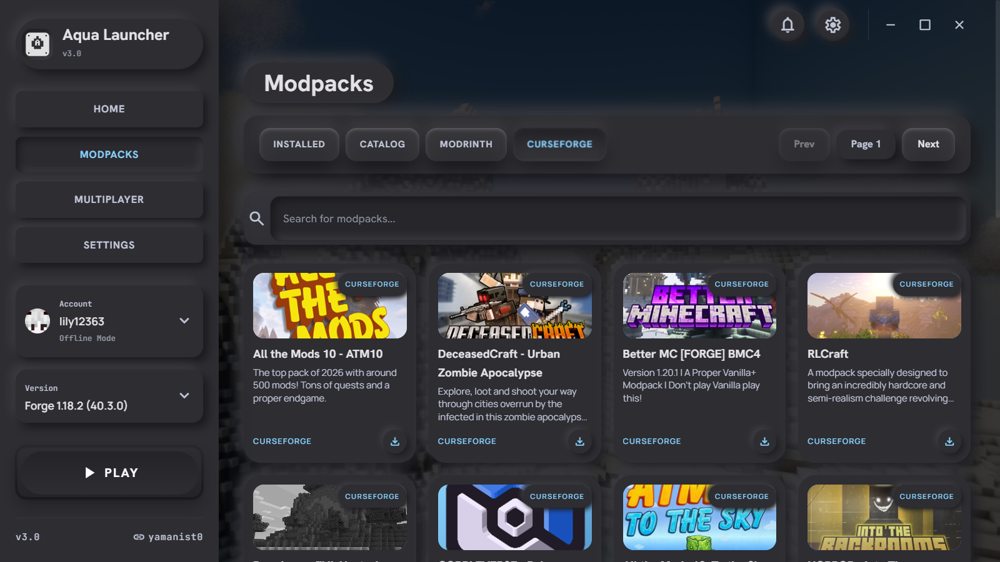
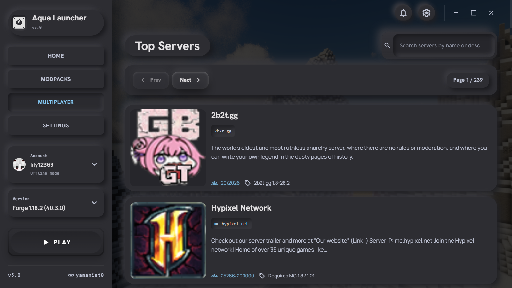
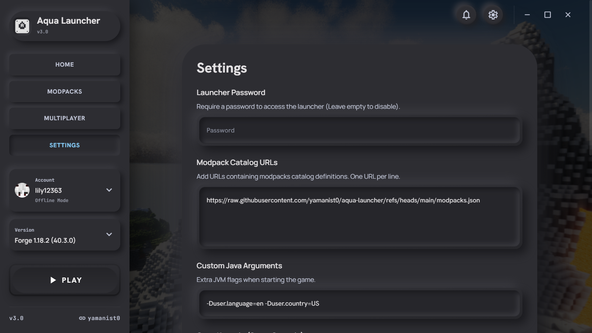

# Aqua Launcher

Aqua Launcher is a Minecraft launcher built with **Tauri 2**, a Rust backend, and an HTML/CSS/JavaScript frontend. It provides a compact desktop interface for signing in, choosing a Minecraft version and mod loader, managing modpacks, browsing servers, and launching the game.

## Features

- **Accounts:** Microsoft sign-in and offline accounts.
- **Game setup and launch:** Browse Minecraft releases, choose supported Fabric or Forge loader versions, preview the selected setup, and launch Minecraft in an isolated launcher data directory. Java detection and installation support are included in the backend.
- **Modpacks:** View installed packs and custom catalogs; search Modrinth and CurseForge; install supported Modrinth `.mrpack` and CurseForge packs; reinstall installed packs.
- **Home:** Browse modpack and server carousels alongside Minecraft news. Home sections can be collapsed, and news loads as you scroll.
- **Multiplayer:** Search and page through the configured server list, see server status/player information, and copy a server address.
- **Settings:** Configure memory allocation, Java arguments, modpack catalog URLs, the server-list URL, the CurseForge proxy, the launch console, and panorama camera/dim settings.
- **Interface:** Resizable, custom-framed desktop window with an animated Minecraft panorama and a neumorphic control style.

## Technology

- [Tauri 2](https://tauri.app/) for the desktop shell and native commands
- Rust for authentication, game setup and launch, modpack management, server queries, and settings
- HTML, CSS, and JavaScript for the interface
- [Lighty Launcher](https://crates.io/crates/lighty-launcher) libraries for Minecraft launcher operations

## Requirements

- Node.js and npm
- Rust toolchain supported by Tauri 2
- Tauri platform prerequisites for your operating system (on Windows, Microsoft C++ Build Tools and WebView2)

See the [Tauri prerequisites](https://tauri.app/start/prerequisites/) for platform-specific setup.

## Development

```sh
git clone https://github.com/yamanist0/minecraft-aqua-launcher.git
cd minecraft-aqua-launcher
npm install
npm run dev
```

To create a distributable build:

```sh
npm run build
```

The npm scripts invoke the Tauri CLI. The frontend entry point is `launcher.html`; native commands and launcher logic live under `src-tauri/src`.

## Interface

### Home

The home screen places the active modpack and launch controls above collapsible horizontal modpack and server carousels, followed by a Minecraft news feed.



### Modpacks

Browse installed modpacks and custom catalogs, or search the Modrinth and CurseForge catalogs. Select a pack to review available files and install it.



### Multiplayer

Search the configured server directory, browse results by page, and copy a server address from its card.



### Settings

Manage catalogs, Java launch arguments, memory, console output, panorama behavior, server-list source, and CurseForge proxy configuration. Account sign-in is available from the account card.



## Data and configuration

Launcher settings and Minecraft data are stored in the Aqua Launcher application data directory. Settings include the catalog and server-list URLs, memory allocation, Java arguments, selected Minecraft version/loader, and panorama preferences. The CurseForge integration uses the configured proxy URL.

## Contributing

1. Fork the repository.
2. Create a branch for your change.
3. Make and commit your changes.
4. Open a pull request with a description of the change.

## License

The project declares the MIT License in its package metadata.

## Contact

[Project repository](https://github.com/yamanist0/minecraft-aqua-launcher)

