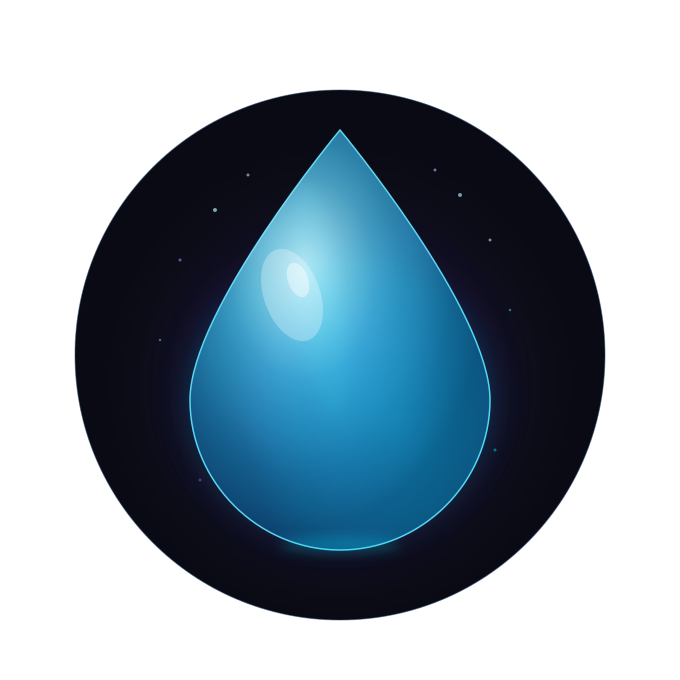

<!-- Improved compatibility of back to top link: See: https://github.com/othneildrew/Best-README-Template/pull/73 -->
<a id="readme-top"></a>

[![Contributors][contributors-shield]][contributors-url]
[![Forks][forks-shield]][forks-url]
[![Stargazers][stars-shield]][stars-url]
[![Issues][issues-shield]][issues-url]
[![MIT License][license-shield]][license-url]

<br />
<div align="center">
  

  <h3 align="center">Aqua Launcher</h3>

  <p align="center">
    A premium, high-performance Minecraft launcher powered by Tauri 2 and Rust, sculpted with a soft neumorphic design language.
    <br />
    <a href="#about-the-project"><strong>Explore the architecture »</strong></a>
    <br />
    <br />
    <a href="#getting-started">Getting Started</a>
    &middot;
    <a href="#usage">Usage Guidelines</a>
    &middot;
    <a href="#page-architecture">Page Previews</a>
  </p>
</div>

<details>
  <summary>Table of Contents</summary>
  <ol>
    <li>
      <a href="#about-the-project">About The Project</a>
      <ul>
        <li><a href="#built-with">Built With</a></li>
        <li><a href="#core-mechanics">Core Mechanics</a></li>
      </ul>
    </li>
    <li>
      <a href="#page-architecture">Page Architecture</a>
      <ul>
        <li><a href="#home-menu">Home Menu</a></li>
        <li><a href="#modpacks-menu">Modpacks Menu</a></li>
        <li><a href="#multiplayer-menu">Multiplayer Menu</a></li>
        <li><a href="#settings-menu">Settings Menu</a></li>
      </ul>
    </li>
    <li>
      <a href="#getting-started">Getting Started</a>
      <ul>
        <li><a href="#prerequisites">Prerequisites</a></li>
        <li><a href="#installation">Installation</a></li>
      </ul>
    </li>
    <li><a href="#roadmap">Roadmap</a></li>
    <li><a href="#contributing">Contributing</a></li>
    <li><a href="#license">License</a></li>
    <li><a href="#contact">Contact</a></li>
  </ol>
</details>

## About The Project

[![Home Menu Screenshot][home-screenshot]](https://github.com/yamanist0/minecraft-aqua-launcher)

Aqua Launcher A custom, standalone and highly optimised Minecraft launcher made with Tauri 2, Rust, and web technologies, designed to replace current launchers by deeply integrating with all world modpack repositories, isolating its own local storage & being buttery smooth to navigate.

Whereas other launchers litter your root Minecraft install with files, Aqua Launcher is designed to leverage isolated environment deployments per modpack instance to provide a clean separation of save states, mod files, Minecraft configuration files, and any other mod dependencies. Aqua Launcher employs heavy use of caching, and dynamically manipulated DOM to simulate the feeling of native application performance, and uses custom proxies to circumvent API rate limitations imposed on CurseForge and Modrinth.

Following the shift from glassmorphism to neumorphism, the interface now renders as a sculpted, tactile surface. Panels, cards, and controls are extruded from the same base tone using paired highlight and shadow offsets, and collapse into engraved wells on interaction, so every element feels physically embedded in the application rather than floating above it.

### Built With

* [![Tauri][Tauri-badge]][Tauri-url]
* [![TailwindCSS][Tailwind-badge]][Tailwind-url]
* [![Node.js][Node-badge]][Node-url]

### Core Mechanics

The launcher pairs a Rust backend running in Tauri with an HTML, CSS, and JavaScript interface rendered in the system WebView.

**Native Commands:** The frontend invokes explicit Tauri commands for authentication, settings, game launching, modpacks, news, and server browsing.
**Authentication:** Supports Microsoft account sign-in and offline accounts through the launcher backend.
**Dynamic Resolution:** Modrinth & CurseForge resource management is made possible through Cloudflare Worker proxies designed to sanitize REST input and overcome rigid CORS requirements, permitting clients to resolve manifest types on the fly and stream content to a local download core.
**Liquid Animations:** Uses CSS transitions for the launcher navigation and controls.
**Neumorphic Surface System:** All panels, cards, and controls are extruded from a shared base tone using dual offset shadows, so resting components lift off the canvas while hovered and activated components press into engraved inset wells, preserving depth cues without a single backdrop blur filter.

<p align="right">(<a href="#readme-top">back to top</a>)</p>

## Page Architecture
The interface is built from HTML views inside a single Tauri window. The page descriptions below reflect the current launcher screens.

### Home Menu

[![Home Menu Screenshot][home-screenshot]](https://github.com/yamanist0/minecraft-aqua-launcher)

The Home Menu brings together the launch controls, active modpack, horizontally scrolling modpack and server cards, and a scrollable Minecraft news feed.

* **Modpack Explorer Carousel:** Showcases prioritized content items immediately in addition to a horizontal flex container. Cards display a proactive structural cover reveal system for mitigating a reflow when unadulterated stream information resolves.
* **Live Server Highlights:** Brings live servers together through stream analysis with native JSON consumption and directly injecting public connections to establish immediate direct play quick-select.
* **News Aggregator:** Shows the latest Minecraft news in a scrollable feed.
* **Persistent State Navigation:** Launcher settings, including memory allocation and the selected game version, are saved between sessions.

### Modpacks Menu

[![Modpacks Menu Screenshot][modpacks-screenshot]](https://github.com/yamanist0/minecraft-aqua-launcher)

Module which manages the actual fetch of custom engine states, and the locale-based rendering and index-mapping of these custom engine states.

* **Four-Tier Architecture:** Seamless tab logic iteratively cycles the application query across Installed Archives, Custom Catalogs, Modrinth Repositories, and the external CurseForge ecosystem.
* **Intelligent File Scaffolding:** Installs Modrinth `.mrpack` and CurseForge modpacks using the Rust backend.
* **Search and Filter Dynamics:** An input sensing protocol tied to native debouncing identifies exhaustion. This triggers secured backend calls producing faceted category information without impact on rigid application state.
* **State Masking:** Unidentified, remote library nodes inject transmissive data flags. States are seamlessly transitionated into bounded conditions directing file operations through to installation ending.

### Multiplayer Menu

[![Multiplayer Menu Screenshot][multiplayer-screenshot]](https://github.com/yamanist0/minecraft-aqua-launcher)

Browse the configured Minecraft server list with search and pagination.

* Asynchronously pings remote Java Edition servers beyond each interval, rendering server densities and playercounts on interactive cards.
* Click a server card to copy its address.
* Server cards show available status and player information.

### Settings Menu

[![Settings Menu Screenshot][settings-screenshot]](https://github.com/yamanist0/minecraft-aqua-launcher)

The Settings page contains launcher and appearance options.

* **Launcher options:** Configure modpack catalog URLs, server-list URL, and the CurseForge proxy.
* **Game options:** Set Java arguments, memory allocation, and whether to open the console when launching.
* **Panorama options:** Control mouse camera movement and background darkness.
* Account sign-in options are available from the account card.

<p align="right">(<a href="#readme-top">back to top</a>)</p>

## Getting Started

To develop or build Aqua Launcher locally, install Node.js, npm, Rust, and the platform prerequisites for Tauri 2.

### Prerequisites

Install Node.js/npm and the Rust toolchain. On Windows, install the Tauri prerequisites, including Microsoft C++ Build Tools and WebView2.
* npm
  ```sh
  npm install npm@latest -g
  ```

### Installation

1. Set your Cloudflare Worker endpoints that relate to your CurseForge parameters (native instances use default placeholder values inside settings).
2. Clone the core repository locally.
   ```sh
   git clone https://github.com/yamanist0/minecraft-aqua-launcher.git
   ```
3. Parse master requirements and fetch modules using standard npm conventions.
   ```sh
   npm install
   ```
4. Start the Tauri development app.
   ```sh
   npm run dev
   ```

<p align="right">(<a href="#readme-top">back to top</a>)</p>

## Usage

Aqua Launcher uses Tauri commands in `src-tauri/src` for native operations and `renderer.js` for the interface. 

1. **Authentication Sequences:** Enable offline parameter bypass or query standard tokens through Microsoft directly in house, no need to be redirecting in the browser with strings.
2. **Dynamic Dependency Selection:** Throw modals in the mix that would be capable of parsing out Vanilla parameters with respective Forge and Fabric arrays in the arrays independently via targeted meta networks so we can be avoiding standard chromium rendering visibility conflicts over top of the absolute position of any element layout we need.
3. **Execution Sequences:** Command strings via direct localized meta checks run specifically across .minecraft/versions architectures loops. Running through our isolated local directory mappings instead of anything breaking the native save locations.

<p align="right">(<a href="#readme-top">back to top</a>)</p>

## Roadmap

- [x] Microsoft backend authorizations to map to Xbox live directly.
- [x] Internal modpack abstraction merging of network endpoints on the local files.
- [x] Internal rendering state triggers for rendering a rigid skeletonmaskingloop to localfiles.
- [x] Integrated and fine tuned controls replacing framework class with scale behavior dynamically.
- [ ] Infinite scroll parsing logic against the chronical notification list.
- [ ] integrated Java installing to provide a fallback to JVM mismatches.

<p align="right">(<a href="#readme-top">back to top</a>)</p>

## Contributing

1. Fork the Environment Sequence
2. Establish your Feature Tracking Context (`git checkout -b feature/Optimization`)
3. Committing Local Branches (`git commit -m 'Implement optimized routing arrays'`)
4. Direct Stream Overrides (`git push origin feature/Optimization`)
5. Finalize Pull Configurations

<p align="right">(<a href="#readme-top">back to top</a>)</p>

## License

Distributed under the MIT License. See `LICENSE` for more information.

<p align="right">(<a href="#readme-top">back to top</a>)</p>

## Contact

Project Link: [https://github.com/yamanist0/minecraft-aqua-launcher](https://github.com/yamanist0/minecraft-aqua-launcher)

<p align="right">(<a href="#readme-top">back to top</a>)</p>

[contributors-shield]: https://img.shields.io/github/contributors/yamanist0/minecraft-aqua-launcher.svg?style=for-the-badge
[contributors-url]: https://github.com/yamanist0/minecraft-aqua-launcher/graphs/contributors
[forks-shield]: https://img.shields.io/github/forks/yamanist0/minecraft-aqua-launcher.svg?style=for-the-badge
[forks-url]: https://github.com/yamanist0/minecraft-aqua-launcher/network/members
[stars-shield]: https://img.shields.io/github/stars/yamanist0/minecraft-aqua-launcher.svg?style=for-the-badge
[stars-url]: https://github.com/yamanist0/minecraft-aqua-launcher/stargazers
[issues-shield]: https://img.shields.io/github/issues/yamanist0/minecraft-aqua-launcher.svg?style=for-the-badge
[issues-url]: https://github.com/yamanist0/minecraft-aqua-launcher/issues
[license-shield]: https://img.shields.io/github/license/yamanist0/minecraft-aqua-launcher.svg?style=for-the-badge
[license-url]: https://github.com/yamanist0/minecraft-aqua-launcher/blob/main/LICENSE
[product-screenshot]: images/screenshot.png
[home-screenshot]: images/home-screenshot.png
[modpacks-screenshot]: images/modpacks-screenshot.png
[multiplayer-screenshot]: images/multiplayer-screenshot.png
[settings-screenshot]: images/settings-screenshot.png
[Tauri-badge]: https://img.shields.io/badge/Tauri-FFC131?style=for-the-badge&logo=Tauri&logoColor=black
[Tauri-url]: https://tauri.app/
[Tailwind-badge]: https://img.shields.io/badge/Tailwind_CSS-38B2AC?style=for-the-badge&logo=tailwind-css&logoColor=white
[Tailwind-url]: https://tailwindcss.com/
[Node-badge]: https://img.shields.io/badge/Node.js-43853D?style=for-the-badge&logo=node.js&logoColor=white
[Node-url]: https://nodejs.org/ 

<p align="center">
  <small>Made with 🤍 by <a href="https://github.com/yamanist0">yamanist</a></small>
</p>


